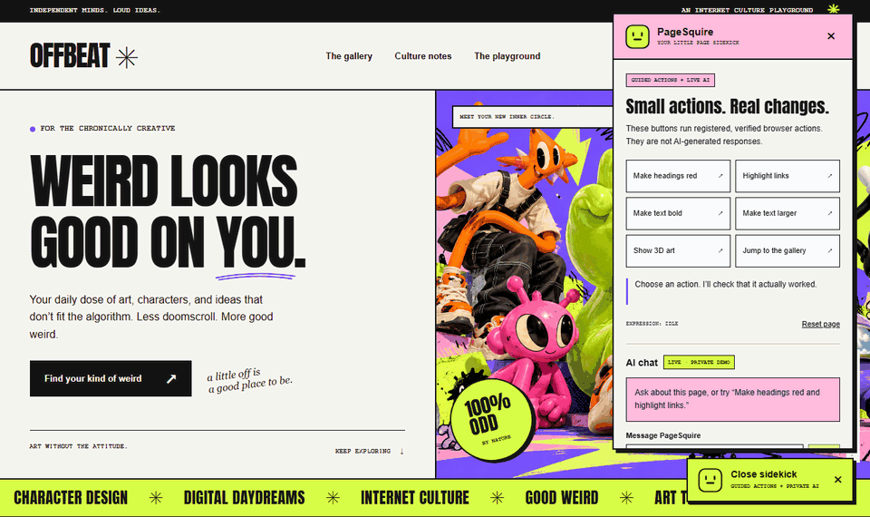

<p align="center">
  <picture>
    <source media="(prefers-color-scheme: dark)" srcset=".github/assets/logo-dark.svg" />
    <source media="(prefers-color-scheme: light)" srcset=".github/assets/logo-light.svg" />
    
  </picture>
</p>

<p align="center">
  <strong>An open-source website assistant that acts on your pages and checks that every action worked.</strong>
</p>

<p align="center">
  <a href="LICENSE"></a>
  <a href="packages/wordpress/LICENSE"></a>
  <a href="CHANGELOG.md"></a>
  <a href="https://github.com/naufaldenta/pagesquire/actions/workflows/ci.yml"></a>
  <a href="https://github.com/naufaldenta/pagesquire/commits/main"></a>
  
  
</p>

<p align="center">
  <a href="#quick-start">Quick start</a> ·
  <a href="https://pagesquire-offbeat-demo.vercel.app/">Live demo</a> ·
  <a href="docs/">Docs</a> ·
  <a href="docs/ROADMAP.md">Roadmap</a> ·
  <a href="CHANGELOG.md">Changelog</a>
</p>

<p align="center">
  
</p>

## PageSquire

PageSquire puts an assistant on your website that can do things, not just answer questions. A visitor asks in plain language, and the assistant carries it out on the page:

- "Make the headings bigger and highlight the links." on a site with accessibility controls
- "Find articles about elections and bookmark the first one." on a news portal
- "Book a table for four tomorrow at seven." on a restaurant site, or hand the visitor to a partner site that can

The assistant can only use actions you register, such as filling a form, opening a page or changing a setting. After each action, PageSquire checks the page to confirm it really happened before the assistant says it is done.

## Why PageSquire?

- **You decide what it can do.** The model chooses only from the actions you register, each with a JSON Schema for its parameters. Text on the page cannot add new permissions.
- **It checks its own work.** Each action has a verifier. The assistant moves on only after the page shows the expected result.
- **Your server, your keys.** The conversation runs on your backend (Node.js, PHP, Laravel or WordPress). API keys never reach the browser.
- **Bring any model.** Presets for OpenAI, OpenRouter, Groq, DeepSeek, Gemini, Mistral, Qwen, GLM and more, or any OpenAI-compatible endpoint.
- **Drop-in or deep integration.** Start with one script tag, or use the React, Next.js, Laravel and WordPress integrations.
- **Built for people, not just bots.** Approvals for consequential steps, a "your turn" handoff for sign-in and payment, an animated cursor, and English and Indonesian out of the box.

## Quick start

### Try it locally

You need Node.js 24+, npm, PHP 8.3 and Composer.

```sh
npm ci
composer install
npm run build
npm run demo
```

Open the address it prints. The demo runs real registered actions without an API key. `npm run demo:chat` adds a PHP conversation loop with a scripted model.

### Add it to your site

```html
<meta name="csrf-token" content="SESSION_BOUND_TOKEN" />
<script
  src="/assets/pagesquire.min.js"
  data-endpoint="/pagesquire/chat"
  data-content-root="main"
  data-pages="/,/about"
  defer
></script>
```

`npm run build` writes the bundle, stylesheet and action catalog to `packages/embed/dist/`. Host them on your site and point `data-endpoint` at a PageSquire backend that loads the same `manifest.json`. See the [one-tag embed guide](packages/embed/README.md).

### Connect a model

Set `PAGESQUIRE_PROVIDER`, `PAGESQUIRE_API_KEY` and `PAGESQUIRE_MODEL` on the server. See [providers](docs/providers.md) for every preset.

## Live demos

- **[OFFBEAT](https://pagesquire-offbeat-demo.vercel.app/)**: an art and culture site with thirteen verified actions. Anyone can use the guided buttons; live AI chat requires the owner's private demo access code. Sessions and usage limits are stored in Supabase PostgreSQL ([setup](examples/brutalist-demo/README.md)).
- **[Kabarin](https://pagesquire-kabarin-demo.vercel.app/)**: an Indonesian news portal with navigation, article reading and summaries, search, bookmarks and guided tours. Five free AI messages per network per day ([source](https://github.com/naufaldenta/pagesquire-kabarin-demo)).

## Features

| Feature                                             | What it does                                                                                                         |
| --------------------------------------------------- | -------------------------------------------------------------------------------------------------------------------- |
| **Verified actions**                                | Run one action at a time, check the result, and support cancelling, timeouts and replay protection.                  |
| **[Assistant driving](docs/assistant-driving.md)**  | Animated cursor, highlights, scrolling, page reading, guided tours and optional speech.                              |
| **[Generic tools](docs/generic-actions.md)**        | Work with forms, filters and dialogs you did not map, with risk-based approvals and recovery when a step fails.      |
| **Visitor in the loop**                             | Ask the visitor to choose, hand over sign-in, CAPTCHA or payment steps, and show a short plan first.                 |
| **[PageSquire Link](docs/link.md)**                 | Pair two PageSquire sites, hand a visitor to a partner site with their consent, and accept requests from A2A agents. |
| **[Approvals](docs/webmcp-and-approval.md)**        | Consequential actions need the server, the host's authorization and the person's approval.                           |
| **[WebMCP](docs/webmcp-and-approval.md)**           | Browser-integrated agents can call the same verified actions.                                                        |
| **[Progress and streaming](docs/streaming.md)**     | Visitors see what the assistant is doing while the model works.                                                      |
| **[Languages](docs/i18n.md)**                       | English and Indonesian built in, following the page language, with per-text overrides.                               |
| **[Traces and evaluation](docs/trace-and-eval.md)** | Record conversations locally, replay them in a viewer, and run a 36-task browser evaluation.                         |
| **[Developer tools](docs/capability-inspector.md)** | A capability inspector, typed [app context](docs/app-context.md) and an [onboarding CLI](docs/onboarding.md).        |

## Integrations

| Stack                   | Guide                                                                                           |
| ----------------------- | ----------------------------------------------------------------------------------------------- |
| Any website, no build   | [One-tag embed](packages/embed/README.md)                                                       |
| Node.js / Next.js       | [Node and Next.js](docs/node-next.md)                                                           |
| Laravel + React/Inertia | [Laravel and React](docs/laravel-react.md)                                                      |
| Plain PHP               | [Standalone PHP](docs/standalone-php.md)                                                        |
| WordPress 7.1+          | [WordPress plugin](packages/wordpress/README.md): upload the ZIP, no Node.js needed on the host |
| Existing project        | [Onboarding CLI](docs/onboarding.md) with an `/assistant-setup` skill for Claude Code and Codex |

## How it works

1. The browser sends the visitor's message and a filtered snapshot of the page to your backend.
2. Your backend asks the model what to do. The model can only pick from the actions you registered.
3. The backend validates the choice and signs it, and the browser runs it.
4. A verifier checks the page. The result goes back to the model, which continues or answers.

Page text, model output and browser results are treated as untrusted data. A browser result never authorizes a change on the server. Read [SECURITY.md](SECURITY.md) and the [operations guide](docs/operations.md) before going live.

## Project status

PageSquire is in beta (`0.1.0-beta.0`). It works end to end and is covered by a large test suite, but it has not been tested on every site, browser and model. Packages are not yet published to npm, Packagist or the WordPress plugin directory, so install from this repository for now. See [status](docs/status.md) and the [roadmap](docs/ROADMAP.md).

## Run the tests

```sh
npm exec -- playwright install chromium
npm test
```

`npm test` builds everything, including the WordPress ZIP and the embed bundle, and then runs the unit and conformance tests, browser tests in Chromium (plain HTML, React, Inertia and Next.js), a real WordPress site, and installs from the packed packages. On Linux, use `playwright install --with-deps chromium`.

## Repository layout

| Path                 | Contents                                               |
| -------------------- | ------------------------------------------------------ |
| `packages/protocol`  | Shared contracts, JSON Schemas and validators          |
| `packages/core`      | Page observation, verified execution and WebMCP bridge |
| `packages/client`    | Conversation loop, transport, chat widget and prompts  |
| `packages/react`     | React components and Inertia and Next.js navigation    |
| `packages/embed`     | The prebuilt one-tag bundle                            |
| `packages/server`    | Node.js engine, model providers and storage            |
| `packages/php`       | PHP engine, endpoints, providers and storage           |
| `packages/laravel`   | Laravel routes, gates and session handling             |
| `packages/wordpress` | WordPress plugin with guided setup                     |
| `packages/cli`       | Onboarding CLI for existing projects                   |
| `examples`           | Local demos and test fixtures                          |
| `docs`               | Guides, contracts and the roadmap                      |

## Contributing

Issues and pull requests are welcome. See [CONTRIBUTING.md](CONTRIBUTING.md) and the [changelog](CHANGELOG.md). Please report security issues privately as described in [SECURITY.md](SECURITY.md).

## License

The packages are released under the [MIT license](LICENSE). The WordPress plugin bundles them under [GPL-3.0-or-later](packages/wordpress/LICENSE); see its [third-party notices](packages/wordpress/THIRD-PARTY.md).
